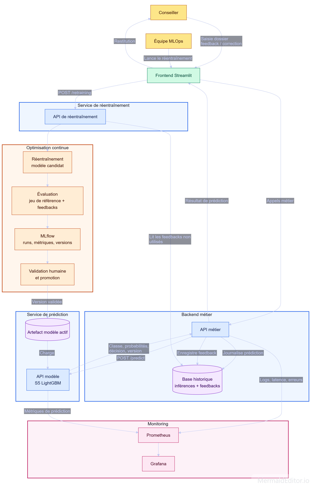

# Atlas CISIA - Prédiction du retour à l'emploi

Projet réalisé dans le cadre de la certification **Atlas CISIA**.

L'objectif est de construire une application MLOps complète pour aider les conseillers à estimer le délai de retour à l'emploi à partir d'un dossier candidat et d'une synthèse d'entretien.

Le modèle retenu est le scénario **S5 LightGBM**:

- les variables numériques `age` et `anciennete_poste_ans` ;
- le niveau de diplôme ;
- des indicateurs de situation administrative et de nationalité ;
- le département, dérivé du code INSEE de la commune ;
- le code ROME complet de l'emploi visé ;
- la synthèse d'entretien, utilisée comme variable catégorielle.

Ce scénario est issu de l'EDA et des expérimentations réalisées dans le notebook **ProjetFinal.ipynb**, où plusieurs configurations de variables et d'algorithmes ont été comparées.

Le modèle prédit trois classes :

- `0` : retour rapide à l'emploi ;
- `1` : retour à l'emploi intermédiaire ;
- `2` : risque de chômage de longue durée.

La prédiction produite par le modèle est une **aide à la décision**. Elle ne remplace ni l'analyse de la situation individuelle ni la décision du conseiller.

Les analyses ont mis en évidence un risque de discrimination indirecte : certaines variables utilisées, notamment l'âge, la nationalité hors UE, le code INSEE, peuvent être associées à des inégalités sociales et territoriales. Même si le modèle ne prend pas une décision explicitement discriminatoire, il peut reproduire des écarts présents dans les données historiques.

Le conseiller conserve donc la décision finale. Il peut contextualiser ou écarter la prédiction et enregistrer un feedback. Aucune orientation ou décision d'accompagnement ne doit être prise automatiquement par le modèle.

## Fonctionnalités - Composants

- **Frontend Streamlit** : 
    - saisie d'un dossier, consultation des prédictions et enregistrement des feedbacks
    - appel du l'API métier
    - accès aux tableaux de suivi de la disponibilité et de la latence
    - accès aux métriques d'évaluation des modèles réentraînés
    - déclenchement du réentrainements depuis l'espace réservé à l'équipe MLOps

- **Service de prédiction**
    - API FastAPI chargeant et exposant le modèle **S5 LightGBM**

- **Service backend métier**
    - API FastAPI métier assurant le contrôle des dossiers, la journalisation et l'enregistrement des feedbacks conseiller

- **Service de réentraînement**
    - API FastAPI réservée à l'équipe MLOps
    - création d'un jeu enrichi à partir des feedbacks --> entraînement d'un candidat --> évaluation et recommandation de promotion

- **Persistance**
      - base SQLite pour les prédictions, les feedbacks et leur statut d'utilisation pour le réentraînement

- **Observabilité**
    - Prometheus et dashborad Grafana pour la disponibilité, la latence et les erreurs des services
    - MLflow pour le suivi des expérimentations, métriques et artefacts du modèle

- **CI/CD** 
    - GitHub Actions enchainant tests --> build Docker --> publication des images dans GitHub Container Registry

## Architecture



## Prérequis

Pour l'exécution locale :

- Git ;
- Docker Desktop avec Docker Compose ;
- Python 3.11, si vous souhaitez lancer les scripts et tests hors conteneur.

## Installation depuis Git

```powershell
git clone https://github.com/ddedomeni-j/Certification-Atlas-Cisia.git
cd Certification-Atlas-Cisia
```

Créez un fichier `.env` à la racine pour gérer l'identification Grafana :

```text
GRAFANA_ADMIN_PASSWORD=changez-ce-mot-de-passe
```

## Artefacts du modèle

Les fichiers binaires du modèle ne sont pas versionnés dans Git. Avant de démarrer l'application, le répertoire `Models/` doit contenir le modèle, ses metadonnées et  :

```text
Models/
  active_model.json
  pipeline_v3.joblib
  pipeline_v3.json
```

Le fichier `active_model.json` désigne la version utilisée en production. Par exemple :

```json
{
  "active_version": "v3"
}
```

Si les artefacts sont disponibles depuis un environnement précédent, copiez-les dans `Models/`.

Sinon, recréez un modèle localement :

```powershell
New-Item -ItemType Directory -Force .\Models
Set-Content -Path .\Models\active_model.json -Value '{"active_version":"v3"}'

python -m venv .venv
.\.venv\Scripts\Activate.ps1
pip install -r requirements.txt

python .\Scripts\train_and_persist.py --version v3
```

Cette commande crée `pipeline_v3.joblib` et ses métadonnées JSON à partir du jeu d'entraînement.

## Démarrage local avec Docker Compose

Construisez et démarrez tous les services :

```powershell
docker compose up -d --build
```

Vérifiez leur état :

```powershell
docker compose ps
```

Arrêtez l'environnement :

```powershell
docker compose down
```

Consultez les logs d'un service :

```powershell
docker compose logs model-api
docker compose logs backend-metier-api
docker compose logs retraining-api
docker compose logs frontend
```

## Services disponibles

| Service | URL |
|---|---|
| Frontend Streamlit | http://localhost:8501 |
| API modèle | http://localhost:8000/docs |
| Santé API modèle | http://localhost:8000/health |
| API métier | http://localhost:8001/docs |
| Santé API métier | http://localhost:8001/health |
| API réentraînement | http://localhost:8002/docs |
| Santé API réentraînement | http://localhost:8002/health |
| Prometheus | http://localhost:9090 |
| Grafana | http://localhost:3000 |
| MLflow | http://localhost:5000 |

## Boucle de réentraînement

Les conseillers enregistrent des feedbacks sur une prédiction existante. L'API de réentraînement est réservée à l'équipe MLOps.

Le cycle est le suivant :

```text
feedbacks non utilisés
-> création du jeu enrichi
-> entraînement d'un candidat
-> évaluation contre le modèle actif
-> recommandation de promotion
-> validation humaine
-> promotion explicite
```

Le réentraînement ne remplace jamais automatiquement le modèle actif.

L'écran **Administration ML** de Streamlit déclenche l'entraînement et produit une recommandation. La promotion doit ensuite être réalisée explicitement avec le script dédié :

```powershell
python .\Scripts\promote_candidate.py --version v4
```

`v4` est un exmple à adapter à la version courante (incrémentation de `v3` dans ce readme).

## Tests locaux

Installez les dépendances puis exécutez les tests :

```powershell
.\.venv\Scripts\Activate.ps1
pytest -v
```

Les tests de contrat chargent le modèle actif. Vérifiez donc que les fichiers attendus existent dans `Models/` avant de les lancer.

## CI/CD

Le workflow GitHub Actions est défini dans `.github/workflows/ci.yml`.

Pour une Pull Request vers `master` :

```text
tests -> build Docker
```

Après fusion vers `master` :

```text
tests -> build Docker -> publication GHCR
```

Les images Docker sont publiées dans GitHub Container Registry sous les noms :

```text
ghcr.io/ddedomeni-j/certification-atlas-cisia/model-api
ghcr.io/ddedomeni-j/certification-atlas-cisia/backend-metier-api
ghcr.io/ddedomeni-j/certification-atlas-cisia/retraining-api
ghcr.io/ddedomeni-j/certification-atlas-cisia/frontend
```

Chaque image est publiée avec :

- `latest` : dernière image validée sur `master` ;
- `sha-<commit>` : image immuable liée à un commit précis.

## Test des images de production

Le fichier `docker-compose.prod.yml` lance les images publiées dans GHCR au lieu de les reconstruire localement.

Authentifiez Docker auprès de GHCR avec un Personal Access Token GitHub disposant du droit `read:packages` :

```powershell
docker login ghcr.io -u ddedomeni-j
```

Dans `docker-compose.prod.yml`, utilisez le même tag immuable pour les quatre services, par exemple :

```yaml
image: ghcr.io/ddedomeni-j/certification-atlas-cisia/model-api:sha-<commit>
```

Téléchargez les images puis démarrez les services :

```powershell
docker compose -f docker-compose.prod.yml pull
docker compose -f docker-compose.prod.yml up -d
docker compose -f docker-compose.prod.yml ps
```

Arrêt :

```powershell
docker compose -f docker-compose.prod.yml down
```

Le fichier Compose de production monte localement le répertoire `Models/`. Il doit donc obligatoirement contenir :

```text
Models/
  active_model.json
  pipeline_<version_active>.joblib
  pipeline_<version_active>.json
```

À terme, ces artefacts devraient être distribués depuis un stockage d'artefacts dédié, par exemple MLflow, plutôt que depuis un volume local.

## Gouvernance du modèle

- Le modèle actif est désigné par `Models/active_model.json`.
- Un candidat est entraîné à partir des feedbacks disponibles.
- Le candidat est comparé au modèle actif sur un jeu de référence gelé.
- La recommandation de promotion est calculée selon des seuils de qualité.
- La promotion est une action humaine explicite.
- Les feedbacks ne sont marqués comme utilisés qu'après réussite complète du cycle.

## Structure principale

```text
Data/                           Jeux de données et base SQLite (backend MLflow et artifact)
frontend/                       Application Streamlit
grafana/                        Provisioning et dashboard Grafana
Models/                         Registre du modèle actif et artefacts de modèle
prometheus/                     Configuration Prometheus
Reports/                        Rapports d'évaluation et recommandations
Scripts/                        Scripts d'entraînement, d'évaluation et de promotion
services/model_api/             API FastAPI exposant le modèle LightGBM
services/backend_metier_api/    API FastAPI métier de contrôle des entrées, de journalisation des requêtes et de persistance SQLite
services/retraining_api/        Orchestration MLOps du réentraînement
tests/                          Tests automatisés
```